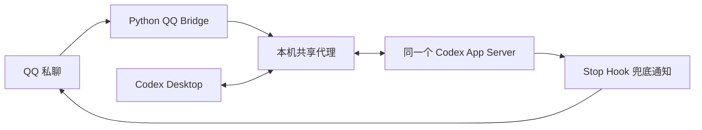

# QQ-Codex-Bridge

用 Python 将 QQ 私聊连接到本机 Codex。你可以从 QQ 选择任务、发送消息和处理审批，也可以在 Codex Desktop 中查看同一任务。QQ 发起的回合流式显示公开的工作过程，结束后另发最终答复；Desktop 发起的回合只向 QQ 同步最终答复。

> 当前实现面向 **Windows + Codex Desktop + Codex CLI**。共享 App Server 使用 Codex 当前版本的实验性 WebSocket 和 Desktop 启动参数；升级 Codex 后请先检查连接状态。

## 功能

- **双向任务消息**：QQ 消息进入 Codex 任务；Desktop 发起的答复完成后同步到 QQ。
- **过程与结论分开**：QQ 发起的回合用一条可更新的消息显示公开说明、可读摘要和工具操作，再用另一条消息发送结论。不会发送重复的“正在回复”进度消息。
- **任务管理**：按 Desktop 项目浏览任务，选择现有任务，或在 QQ 中选择项目、模型和思考强度创建任务。
- **审批与权限**：只有配置的 QQ 用户可以发指令和处理桥接所发起回合的审批；Codex 原有权限设置仍然生效。
- **持久状态**：SQLite 保存 QQ 引用与 Codex 任务的对应关系、消息去重和回合发送状态。

## 工作方式



共享代理让 Desktop 和 QQ 桥接连接同一个 App Server，避免两套独立进程争抢同一任务的写入权。代理将回合事件广播给两个客户端，将审批请求交给发起该回合的客户端。QQ 私聊流式输出使用平台的 `stream_messages` 接口；Desktop 主动发起的消息没有 QQ 入站 `msg_id`，因此只在结束时发送普通消息。

## 安装与启动

### 前提

1. Windows、Python 3.11+、已安装并登录的 [Codex Desktop 与 Codex CLI](https://developers.openai.com/codex)。命令行中应能运行 `py -3` 和 `codex`。
2. 已在 [QQ 开放平台](https://q.qq.com/)创建机器人，取得 App ID、App Secret，并开通所需的私聊消息能力。
3. 机器在运行期间能够连接 QQ Gateway 和 Codex 服务。

下载项目并安装依赖：

```powershell
git clone https://github.com/SparkUiX/QQ-Codex-Bridge.git
cd QQ-Codex-Bridge
py -3 -m pip install -r .\requirements.txt
```

把机器人凭据和允许操作的用户 OpenID 存入**当前 Windows 用户**环境变量。以下值仅为占位符：

```powershell
[Environment]::SetEnvironmentVariable('QQBOT_APP_ID', 'YOUR_APP_ID', 'User')
[Environment]::SetEnvironmentVariable('QQBOT_APP_SECRET', 'YOUR_APP_SECRET', 'User')
[Environment]::SetEnvironmentVariable('QQBOT_USER_OPENID', 'YOUR_OPENID', 'User')
```

重新打开终端，使新环境变量生效。不要把真实凭据写入仓库。桥接也会读取当前用户注册表中的这些值，供登录自启使用。

为完成通知配置用户级 `Stop` Hook：在 `%USERPROFILE%\.codex\hooks.json` 的 `hooks.Stop` 中加入以下处理器，将路径改为本机的**绝对路径**。如果已有 `Stop` 配置，合并处理器，避免重复注册。Codex 可能要求通过 `/hooks` 信任新 Hook；参见[官方 Hooks 文档](https://learn.chatgpt.com/docs/hooks)。

```json
{
  "hooks": {
    "Stop": [
      {
        "hooks": [
          {
            "type": "command",
            "command": "py -3 \"C:\\path\\to\\QQ-Codex-Bridge\\qq_notify.py\"",
            "timeout": 30
          }
        ]
      }
    ]
  }
}
```

首次共享启动前，完整退出 Codex Desktop 和旧桥接进程，然后运行：

```powershell
py -3 .\start_shared.py
```

以后也通过该启动器打开 Desktop。直接从开始菜单打开可能重新使用 Desktop 私有 App Server。启动器提供 `--no-desktop` 和 `--no-bridge` 选项；普通使用无需设置。`http://127.0.0.1:17653/healthz` 应显示 `upstream: true`，客户端列表应包含 `Codex Desktop` 与 `Codex QQ Bridge`。当前已运行的 CLI 会话不会自动迁入共享服务。

可选：运行 `py -3 .\install_startup.py` 配置当前用户**下次登录**时静默启动；用 `py -3 .\install_startup.py --remove` 取消。安装自启不会重启当前进程。

## QQ 指令

| 指令 | 用途 |
| --- | --- |
| `/projects` | 查看 Desktop 项目 |
| `/list`、`/list 项目编号 [页码]` | 查看项目和最近任务 |
| `/use 任务编号` | 选定任务；引用机器人的任务消息时优先使用引用对应的任务 |
| `/new`、`/new 项目编号` | 依次选择项目、模型和思考强度，新建任务 |
| `/status` | 查看选定任务和共享连接状态 |
| `/quota` | 查看 Codex 额度窗口 |
| `/help` | 查看指令帮助 |

选择任务后，直接发送普通 QQ 消息即可继续对话。QQ 不显示 `/new` 按钮时，可按消息提示使用 `/pick 编号` 和 `/page 页码`。桥接发来的审批请求可在五分钟内用 `批准 编号` 或 `拒绝 编号` 回答。

`qq_menu.py` 默认只预览 QQ 命令面板。需要在 QQ 客户端使用 `/` 补全时，可手动运行 `py -3 .\qq_menu.py --apply-panel` 为指定用户更新私聊面板。`--apply` 会覆盖全局菜单，请仅在确实需要时使用。启动和测试不会自动修改 QQ 菜单。

## 状态、限制与排查

- 日志、Gateway 会话和 SQLite 数据位于 `%LOCALAPPDATA%\CodexQQ`。保留 `bridge.sqlite3`，它保存消息去重和引用路由；同一 Windows 用户只运行一个桥接进程。
- `/status` 的 `notLoaded` 只表示当前 App Server 未在内存中加载该任务，并不能证明其他进程没有写入权。若其他独立 Codex 进程持有写入权，桥接会在明确收到 `active writer` 错误时复制任务，并向 QQ 告知新任务 ID；两个任务此后独立。
- QQ `READY` 只说明 QQ Gateway 已连接。共享服务还需检查 `/healthz` 或 `/status`。共享服务断线后桥接会提示并尝试重连，不会悄悄退回独立 App Server。
- QQ 流式接口仅适用于私聊；平台权限、消息时效和配额可能影响显示。无法流式发送时，最终答复仍可通过普通消息或 `Stop` Hook 兜底。QQ 端是否按预期渲染 Markdown 应以实际客户端为准。
- Desktop 项目归属读取其内部状态文件；Codex 升级后若格式变化，需要复核此集成。

## 开发验证

```powershell
py -3 -m unittest -v test_codex_client test_qq_bridge test_qq_notify test_codex_listing test_qq_quota
py -3 -m py_compile qq_bridge.py qq_notify.py qq_state.py codex_client.py codex_projects.py codex_listing.py qq_menu.py qq_stream.py qq_quota.py install_startup.py shared_runtime.py start_shared.py
```

测试使用假 QQ API 和假 App Server 事件，不会提交真实 Codex 提示词，也不会更新 QQ 菜单。现场检查可确认桥接日志出现 `QQ READY`，并确认 `/healthz` 同时列出 Desktop 与 QQ 桥接。

## 许可

本项目采用 [MIT License](LICENSE)。QQ Bot、Codex 与各自平台服务遵循其自身条款。
